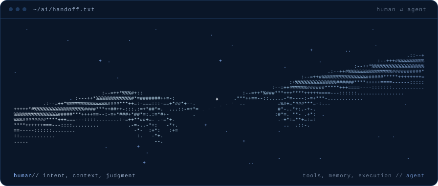

 <div align="center">

  

  <br />

  <a href="https://portfoledu.vercel.app/"></a>
  <a href="https://www.linkedin.com/in/eduardo-lima-416266394/"></a>
  <a href="https://www.instagram.com/eduardoansl/"></a>
  <a href="mailto:limaeduardoans789@gmail.com"></a>

</div>


## `01` About me

I'm Eduardo, a software developer and Systems Development student from São Paulo, Brazil.

I'm interested in understanding how software works beyond the surface. I enjoy exploring computer science fundamentals, building tools from scratch, and turning ideas into practical software.

My interests span **software engineering, artificial intelligence, systems design, and applied mathematics**. I'm particularly curious about how mathematical concepts and computational methods can be used to solve complex problems.

Outside programming, I'm interested in astronomy and mathematics. I've also participated in academic olympiads, earning medals in both mathematics and astronomy.

<table border="0">
  <tr>
    <td width="60%" valign="middle" style="border: none;">

```javascript
import Developer from 'Developer';

class AboutMe extends Developer {
  name = 'Eduardo Andrade da Silva Lima';
  role = 'Software Developer & Student';
  age = 16;
  english = 'Intermediate';
  spanish = 'Advanced';
  location = 'São Paulo, Brazil';
  website = 'https://portfoledu.vercel.app';
}

class Interests extends Developer {
  engineering = [
    'Software Engineering',
    'Systems Design',
    'Computer Science'
  ];

  exploring = [
    'Artificial Intelligence',
    'Applied Mathematics',
    'Cybersecurity',
    'Cloud Computing'
  ];
}

class Currently extends Developer {
  building = [
    'Developer Tools',
    'Web Platforms',
    'SaaS Applications'
  ];

  learning = [
    'Algorithms & Data Structures',
    'System Internals',
    'AI Agent Architecture'
  ];
}
```

  </td>
  <td width="60%" valign="middle" style="border: none;">
    
  </td>
</tr>
</table>


## `02` Technologies & tools

<div align="center">

<table>
  <tr>
    <td align="right"><sub><code>languages</code></sub></td>
    <td></td>
  </tr>
  <tr>
    <td align="right"><sub><code>frontend</code></sub></td>
    <td></td>
  </tr>
  <tr>
    <td align="right"><sub><code>backend</code></sub></td>
    <td></td>
  </tr>
  <tr>
    <td align="right"><sub><code>databases</code></sub></td>
    <td></td>
  </tr>
  <tr>
    <td align="right"><sub><code>tools & cloud</code></sub></td>
    <td></td>
  </tr>
</table>

</div>


## `03` AI & orchestration

<div align="center">

  

  <br />

  
  
  
  

</div>

I'm exploring how AI systems can interact with external tools, coordinate tasks, and automate complex workflows.

My current interests include **AI agent architecture, tool integration, shared context, and multi-agent orchestration**. I also experiment with workflows involving GitHub, Figma, and other development tools.

I'm particularly interested in understanding how these systems can become more reliable, useful, and autonomous.


## `04` Research interests

I'm interested in the intersection of computer science, mathematics, and artificial intelligence.

Some topics I want to explore further:

- **Machine Learning:** mathematical foundations, optimization, and model behavior.
- **Algorithms:** computational complexity, data structures, and algorithm design.
- **Applied Mathematics:** numerical methods, probability, statistics, and optimization.
- **AI Systems:** agent architectures, distributed coordination, and computational efficiency.

My goal is to develop a stronger theoretical foundation while building practical implementations and exploring opportunities for collaborative research.


## `05` Projects on GitHub

<table>
  <tr>
    <td width="50%" valign="top">
      <sub><code>javascript · node.js</code></sub>
      <h3>Build Your Own Git</h3>
      <p>Recreating Git in <b>JavaScript and Node.js</b> to understand file systems, SHA-1 hashing, Git objects, and the internals of version control. <i>In progress.</i></p>
      <p><a href="https://github.com/EduardoAndradeSLima/construa-seu-proprio-git-em-node"></a></p>
    </td>
    <td width="50%" valign="top">
      <sub><code>react · express · supabase</code></sub>
      <h3>FacilitaGRU — Hackathon GRU</h3>
      <p>A web platform designed to support the screening and management of social-assistance placements in Guarulhos. Built with <b>React, Node.js, Express, and Supabase</b>.</p>
      <p><a href="https://github.com/EduardoAndradeSLima/hackathon-gru26"></a></p>
    </td>
  </tr>
  <tr>
    <td width="50%" valign="top">
      <sub><code>python · streamlit</code></sub>
      <h3>Radar Logístico</h3>
      <p>A <b>Python and Streamlit</b> dashboard for monitoring delivery delays, comparing carriers, filtering performance metrics, and exploring logistics data.</p>
      <p><a href="https://github.com/EduardoAndradeSLima/dashboard-logistico"></a></p>
    </td>
    <td width="50%" valign="top">
      <sub><code>angular · node.js · mongodb</code></sub>
      <h3>Booking System</h3>
      <p>A scheduling application built with <b>Angular, Node.js, and MongoDB</b>, with separate frontend and backend components.</p>
      <p><a href="https://github.com/EduardoAndradeSLima/booking-system"></a></p>
    </td>
  </tr>
</table>

<p align="center">
  <a href="https://github.com/EduardoAndradeSLima?tab=repositories">View all my GitHub repositories →</a>
</p>


## `06` Achievements & experience

- 🥇 **Gold medal — Brazilian Astronomy Olympiad (OBA)**
- 🥉 **Bronze medal — Brazilian Mathematics Olympiad (OBMEP)**
- 🏆 **2nd place — Programming competition**, competing against teams from FATEC
- 🤝 **Hackathons and collaborative projects** focused on practical problem-solving
- 💻 **Software development for real businesses**, including management systems and digital platforms


## `07` GitHub stats

<p align="center">
  
  
</p>

<p align="center">
  
</p>


<div align="center">

  <i>Building things, understanding how they work, and exploring what's possible.</i>

</div>
