<div align="center">
  

  <br />

  

  <br /><br />

  <a href="https://portfoledu.vercel.app/"></a>
  <a href="https://www.linkedin.com/in/eduardo-lima-416266394/"></a>
  <a href="mailto:limaeduardoans789@gmail.com"></a>
</div>

<br />


## About me

I'm **Eduardo Andrade**, a **16-year-old software developer** and **Systems Development student at ETEC Guarulhos**, based in São Paulo, Brazil.

I enjoy building products that people can actually use — from **web applications and SaaS platforms** to **developer tools**. I'm especially interested in what happens behind the interface: architecture, backend systems, performance, and how software works under the hood.

Outside the classroom, I work on personal and real-world projects, participate in programming competitions, and explore new ideas involving **artificial intelligence, cloud computing, and cybersecurity**.

```javascript
const eduardo = {
  role: 'Student & Software Developer',
  location: 'São Paulo, Brazil',
  education: 'Systems Development @ ETEC Guarulhos',
  building: ['SaaS', 'Web Applications', 'Developer Tools'],
  exploring: ['Backend', 'System Design', 'AI', 'Cybersecurity'],
  spokenLanguages: {
    portuguese: 'Native',
    english: 'Intermediate',
    spanish: 'Advanced'
  },
  mindset: 'Build. Understand. Improve.'
};
```


## Technologies & tools

<div align="center">

**Languages**


**Frontend**


**Backend**


**Databases**


**Tools & cloud**


</div>


## Featured projects

<table>
  <tr>
    <td width="50%" valign="top">
      <h3>🛠️ Build Your Own Git</h3>
      <p>Recreating core Git concepts using <b>JavaScript and Node.js</b> to understand version control, hashing, objects and the CLI.</p>
      <p><a href="https://github.com/EduardoAndradeSLima/construa-seu-proprio-git-em-node">View repository →</a></p>
    </td>
    <td width="50%" valign="top">
      <h3>💈 Barbershop Management System</h3>
      <p>A web-based management application built for a real barbershop, with a focus on usable workflows and day-to-day operations.</p>
      <p><a href="https://novo-imperio-app.expo.app/">Live application →</a></p>
    </td>
  </tr>
  <tr>
    <td width="50%" valign="top">
      <h3>🏙️ Hackathon GRU 2026</h3>
      <p>A hackathon web project developed with <b>React, Node.js and Express</b>, focused on solving practical problems.</p>
      <p><a href="https://github.com/EduardoAndradeSLima/hackathon-gru26">View repository →</a></p>
    </td>
    <td width="50%" valign="top">
      <h3>🚀 Leadfy</h3>
      <p>A responsive landing page designed with an emphasis on clarity, visual presentation and conversion.</p>
      <p><a href="https://leadfy-landing-nine.vercel.app/">Live website →</a></p>
    </td>
  </tr>
</table>

<p align="center">
  <a href="https://portfoledu.vercel.app/">Explore more projects and case studies on my portfolio →</a>
</p>


## Achievements & experience

- 🥇 **Gold medal — Brazilian Astronomy Olympiad (OBA)**
- 🥉 **Bronze medal — Brazilian Mathematics Olympiad (OBMEP)**
- 🏆 **2nd place — Programming competition**, competing against teams from FATEC
- 🤝 **Hackathons and collaborative projects** focused on practical problem-solving
- 💻 **Software for real businesses**, including web platforms and management systems


## Currently exploring

I'm interested in combining **software engineering and artificial intelligence** to create products that are useful, scalable, and thoughtfully designed. Lately, I've been studying how to build systems from scratch, improve backend architecture, and experiment with AI-powered applications.


## GitHub statistics

<div align="center">
  
  

  <br />

  
</div>

<!--
🐍 CONTRIBUTION SNAKE
The file below is generated by .github/workflows/snake.yml.
After the GitHub Actions workflow has run successfully and the output branch
contains snake.svg and snake-dark.svg, remove this opening comment and
its matching closing comment to display the animation.

<div align="center">
  <picture>
    <source media="(prefers-color-scheme: dark)" srcset="https://raw.githubusercontent.com/EduardoAndradeSLima/EduardoAndradeSLima/output/snake-dark.svg" />
    <source media="(prefers-color-scheme: light)" srcset="https://raw.githubusercontent.com/EduardoAndradeSLima/EduardoAndradeSLima/output/snake.svg" />
    
  </picture>
</div>
-->


## Where to find me

<div align="center">
  <a href="https://www.linkedin.com/in/eduardo-lima-416266394/"></a>
  <a href="https://www.instagram.com/eduardoansl/"></a>
  <a href="mailto:limaeduardoans789@gmail.com"></a>
  <a href="https://portfoledu.vercel.app/"></a>

  <br /><br />

  <i>Building, learning, and improving — one project at a time.</i>
</div>
