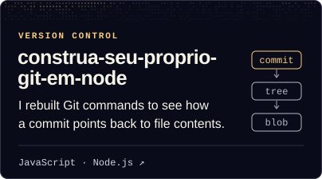
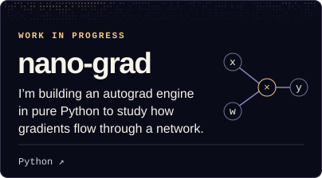
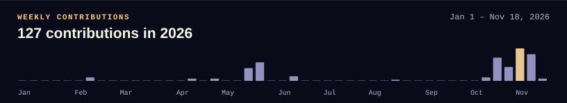

## More projects

- **[TáChegando-Zap](https://github.com/EduardoAndradeSLima/TaChegando-Zap)** — A WhatsApp delivery assistant built with TypeScript and SQLite. It checks addresses, estimates delivery times and hands conversations over to a support agent.
- **[hackathon-gru26](https://github.com/EduardoAndradeSLima/hackathon-gru26)** — FacilitaGRU helps social assistance staff in Guarulhos screen applications and manage placements. Built with React, Express and Supabase.
- **[dashboard-logistico](https://github.com/EduardoAndradeSLima/dashboard-logistico)** — A Python and Streamlit dashboard for tracking delivery delays and comparing carriers.

## Tools I use

**Languages**

**Frontend**

**Backend**

**Databases**

**Data & visualization**

**Tools & cloud**

## Open source

- **OpenBB** — I fixed how the SEC data provider downloads XBRL taxonomy labels and proposed a correction to the downside deviation used in the Sortino ratio. [Merged fix #7831](https://github.com/openbq-org/OpenBB/pull/7831) · [Proposed fix #7834](https://github.com/openbq-org/OpenBB/pull/7834)
- **SQLGlot** — I fixed how the transpiler handles Teradata’s overloaded `TRUNC` function. [Merged PR #8980](https://github.com/tobymao/sqlglot/pull/8980)
- **OpenTelemetry Python** — I fixed the SQLAlchemy instrumentation tests so they close asynchronous database engines after use. [Merged PR #5298](https://github.com/open-telemetry/opentelemetry-python-contrib/pull/5298)

## Achievements & Competitions

- **2nd place** in a programming competition against teams from FATEC.
- **Gold medal** at the Brazilian Astronomy Olympiad (OBA).
- **Bronze medal** at the Brazilian Public School Mathematics Olympiad (OBMEP).
